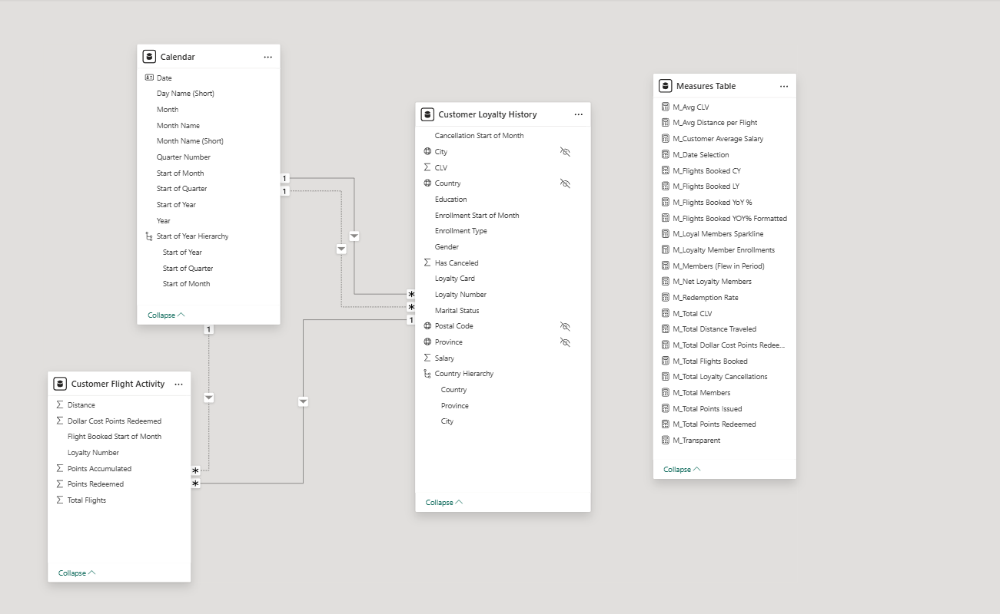

# Airline model explanation



The model combines customer flight activity with loyalty-history attributes and a shared Calendar table. A separate Measures Table organizes the report's calculations.

[Project overview](../README.md) · [Data dictionary](../Data_Dictionary.md) · [DAX documentation](../Dax%20Measures/README.md) · [Validation notes](../Docs/Validation.md)

## Tables and reporting roles

| Table | Reporting role |
|---|---|
| Customer Flight Activity | Member-level activity by reporting month, including flights, distance, accumulated points, redeemed points, and redemption cost. |
| Customer Loyalty History | Customer identifiers, geography, demographic attributes, loyalty tier, CLV, and membership dates. |
| Calendar | Date attributes used for reporting selections, activity calculations, membership calculations, and date labels. |
| Measures Table | Disconnected table used to organize DAX measures. |

The intended activity-table grain is loyalty member × flight month. The intended customer-table grain is one record per Loyalty Number.

These describe the intended model structure. Source-record uniqueness has not been independently verified against the complete dataset.

## Relationships shown in the diagram

The diagram shows:

- An active one-to-many relationship from Customer Loyalty History to Customer Flight Activity, with filtering toward activity.
- An active relationship from Calendar to Customer Loyalty History.
- An inactive relationship from Calendar to Customer Loyalty History.
- An inactive relationship from Calendar to Customer Flight Activity.
- A disconnected Measures Table.

The diagram does not expose the exact column endpoints of every relationship.

The supplied DAX expressions identify the flight-month and cancellation-month relationships used by the measures. The endpoint of the active Calendar-to-history relationship is not confirmed by the available diagram.

## Flight-activity date role

The activity measures use:

```dax
USERELATIONSHIP(
    'Calendar'[Date],
    'Customer Flight Activity'[Flight Booked Start of Month]
)