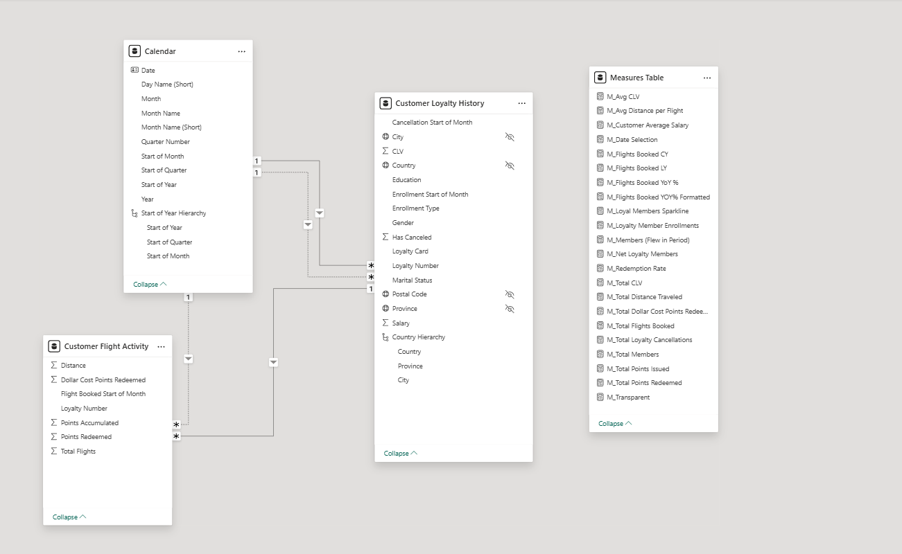

# Airline model explanation



The model combines customer flight activity with loyalty-history attributes and a shared Calendar table. A separate Measures Table organizes the report's calculations.

[Project overview](../README.md) · [Data dictionary](../Data_Dictionary.md) · [DAX documentation](../Dax%20Measures/README.md) · [Validation notes](../Docs/Validation.md)

## Tables and reporting roles

| Table | Reporting role |
|---|---|
| Customer Flight Activity | Member-level activity by reporting month, including flights, distance, accumulated points, redeemed points, and redemption cost. |
| Customer Loyalty History | Customer identifiers, geography, demographic attributes, loyalty tier, CLV, and membership dates. |
| Calendar | Date attributes used for reporting selections, activity calculations, membership calculations, and date labels. |
| Measures Table | Disconnected table used to organize DAX measures. |

The intended activity-table grain is loyalty member × flight month. The intended customer-table grain is one record per Loyalty Number.

The source customer table contains 16,737 unique loyalty numbers and every activity row matches one of them. Activity has 392,936 rows for 389,065 unique member-months. Aggregate the flight amounts across repeated member-months.

## Relationships shown in the diagram

The diagram shows:

- An active one-to-many relationship from Customer Loyalty History to Customer Flight Activity, with filtering toward activity.
- An active relationship from Calendar to Customer Loyalty History.
- An inactive relationship from Calendar to Customer Loyalty History.
- An inactive relationship from Calendar to Customer Flight Activity.
- A disconnected Measures Table.

The diagram does not expose the exact column endpoints of every relationship.

The DAX expressions identify the flight-month and cancellation-month relationships used by the measures. The diagram leaves the endpoint of the active Calendar-to-history relationship unspecified.

## Flight-activity date role

The activity measures use:

```dax
USERELATIONSHIP(
    'Calendar'[Date],
    'Customer Flight Activity'[Flight Booked Start of Month]
)
```

This relationship places each flight in the month recorded in the activity file. The cancellation measure uses cancellation month to count members leaving the program.
