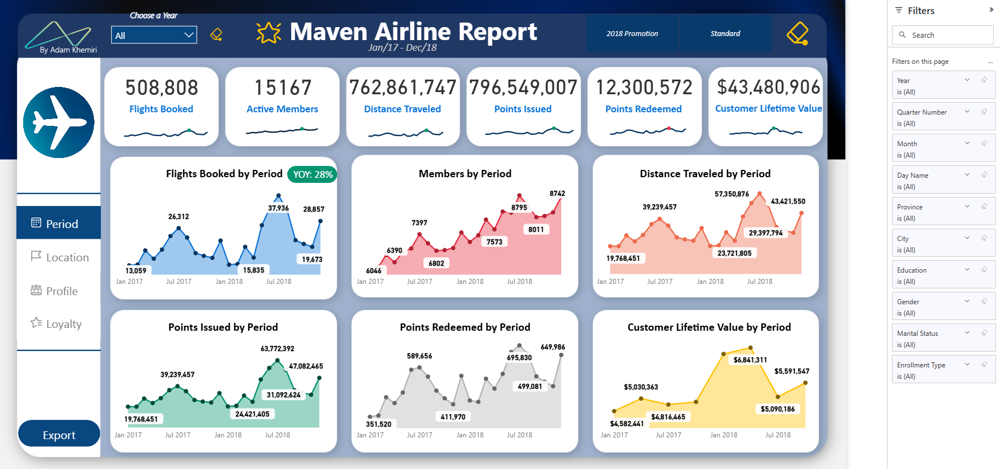

# Airline Loyalty Analysis · Power BI

**Flights rose 27.9% in 2018.** July was the busiest month in both years and grew 44.2%. The report explores the timing and geographic distribution of activity for Northern Lights Air, a fictional Canadian airline.

**Reading the membership figures.** Across both years, **15,167 of 16,737 members** took at least one flight. The report’s Active Members card counts those flyers. The Export table’s “Loyal Members” column subtracts cancellations twice, so it cannot measure membership growth. [Membership calculations](Docs/Validation.md#membership-calculation-interpretation)

[Live Power BI report](https://app.powerbi.com/view?r=eyJrIjoiMmVlM2ZlNTctYjU4MS00OTAxLTg4MmUtYWNkNjg1Y2Q3MGYzIiwidCI6ImIyZDQ1OTA3LTUwOWItNDQ5Ni05YmQzLTVhNjBjN2YwZjM4MCIsImMiOjN9) · [Source dataset](https://mavenanalytics.io/data-playground/airline-loyalty-program) · [Validation notes](Docs/Validation.md)

## When did flight activity grow?

I summed the source activity records by flight month. Flights rose from **223,262 in 2017 to 285,546 in 2018**, an increase of 62,284. July rose from 26,312 to 37,936 flights. Those figures support a closer look at summer demand. Establishing an effect from the 2018 enrollment promotion would require a comparison group and comparable pre-promotion activity.

## Why do the tier chart and headline differ?

The headline includes all provinces. The saved tier and education charts rank provinces by flight volume and retain the top six. I joined flight activity to customer history by loyalty number and reproduced every displayed tier and education total under that filter.

| Loyalty tier | All provinces | Top six provinces shown in chart |
|---|---:|---:|
| Star | 231,051 | 212,596 |
| Nova | 172,817 | 158,810 |
| Aurora | 104,940 | 96,453 |
| **Total flights** | **508,808** | **467,859** |

The other five provinces account for **40,949 flights**. Star leads in both views. To compare member engagement, use flights per member within the same geography and period. [Saved tier chart](Docs/Screenshots/04-Loyalty.png) · [Source and filter checks](Docs/Validation.md#breakdown-reconciliation)

## Model and interpretation

The report combines monthly flight activity, customer loyalty history, and a calendar. Power BI pages support drill-through by time, location, customer profile, and tier. DAX measures use distinct date roles for flight activity, cancellations, and membership cutoffs.

Customer lifetime value comes from the source customer file. The report aggregates that value across the members visible under each filter.

[Model diagram and relationships](Model/README.md) · [DAX expressions](Dax%20Measures/Measures.DAX) · [Data dictionary](Data_Dictionary.md) · [Report screenshots](Docs/Screenshots)
