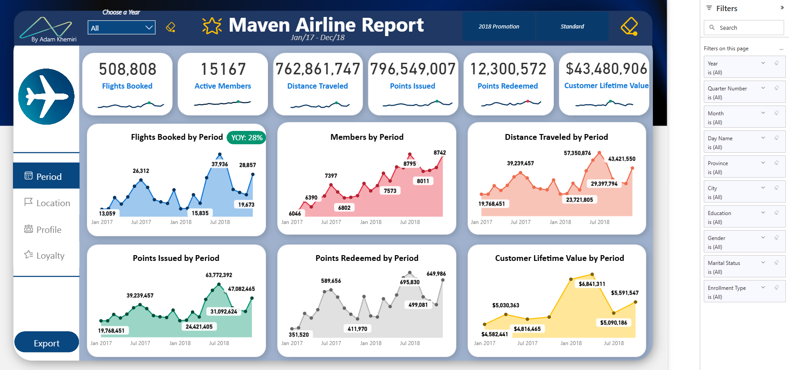

# Maven Airline Loyalty Analysis — Power BI

**How does flight activity change across seasons and loyalty tiers?**

Flight activity increased from 223,262 in 2017 to 285,546 in 2018. July was the busiest month in both displayed years, while Star led the displayed loyalty tiers in total flights. This report explores those patterns through time, location, customer profile, and loyalty views.

[Live dashboard](https://app.powerbi.com/view?r=eyJrIjoiMmVlM2ZlNTctYjU4MS00OTAxLTg4MmUtYWNkNjg1Y2Q3MGYzIiwidCI6ImIyZDQ1OTA3LTUwOWItNDQ5Ni05YmQzLTVhNjBjN2YwZjM4MCIsImMiOjN9) · [Data dictionary](Data_Dictionary.md) · [Model](Model/README.md) · [DAX documentation](Dax%20Measures/README.md) · [Validation notes](Docs/Validation.md)

## Project scope

- **Flight-activity period:** January 2017–December 2018.
- **Data tables:** Customer Flight Activity and Customer Loyalty History, supported by Calendar.
- **Reporting perspectives:** time, province, education, and loyalty tier.
- **Tools:** Power BI, DAX, and data modeling.

The report combines flight activity with customer attributes to compare flights, distance, points, membership, and customer lifetime value.

The model separates activity records from customer history. Measures use different date roles for flight activity, cancellations, and membership cutoffs.

This repository documents a portfolio analysis. Detailed dataset attribution and preparation history are not yet included.

## Key findings

The annual comparison uses the recorded year-filtered totals. Tier figures come from the saved Loyalty view with All years selected.

### 1. Flight activity increased by 27.9%

The report shows **223,262 flights in 2017** and **285,546 in 2018**—an increase of **62,284 flights**, or **27.9%**.

The two annual totals reconcile to the **508,808** full-period headline.

**Recommended next step:** compare monthly and customer-cohort contributions to identify where the increase occurred. The annual change alone does not establish that the 2018 promotion caused the increase.

### 2. July's peak grew faster than the annual total

July flight activity rose from **26,312 in 2017** to **37,936 in 2018**, an increase of **44.2%**, compared with **27.9%** for the year overall.

July was the busiest month in both displayed years.

**Recommended next step:** examine which customer groups contributed to the summer peak and use that analysis to inform seasonal loyalty communications. Two years of activity provide a starting point for further analysis rather than a complete demand forecast.

### 3. Star led the displayed loyalty tiers in flight volume

The saved Loyalty view shows:

| Loyalty tier | Displayed flights |
|---|---:|
| Star | 212,596 |
| Nova | 158,810 |
| Aurora | 96,453 |

These values establish the ranking within the displayed chart. They total **467,859 flights**, which is **40,949 below** the **508,808** headline.

Tier shares of the headline total are therefore excluded from the findings.

**Recommended next step:** reconcile the chart and headline measure assignments and filters, then compare flights per member using a consistent member definition. A larger flight total alone does not establish stronger engagement per member.

[View the loyalty-tier comparison](Docs/Screenshots/04-Loyalty.png)

## Model and report design

- **Activity measures:** flights, distance, points issued, points redeemed, and redemption cost use the flight-month relationship.
- **Membership measures:** separate expressions address members with activity records, members with positive flights, cancellations, and membership cutoffs.
- **Customer-level calculations:** total CLV, average CLV, and average salary iterate over distinct loyalty numbers.
- **Year comparison:** the flight-comparison measures explicitly compare 2018 against 2017.
- **Navigation:** Period, Location, Profile, and Loyalty views, with year and enrollment-type selections.
- **Detail views:** six drill-through destinations and saved tooltip designs support closer inspection.
- **Display helpers:** reporting-period labels, formatted comparison text, and transparent-color formatting.

The [DAX reference](Dax%20Measures/README.md) documents the 22 measure expressions supplied from the current Power BI model.

[Model diagram](Model/README.md) · [Flight drill-through screenshot](Docs/Screenshots/07-Flights-Booked-Drill-Through.png) · [Tooltip example](Docs/Screenshots/13-Flights-Booked-Tooltips.png)

## Validation and limitations

The recorded live review checked year and promotion selections and a Flights Booked drill-through. July 2018's **37,936 flights** carried into the detail view, and returning preserved the 2018 main-view selection.

The annual and July growth figures above were calculated directly from recorded totals. The current DAX definitions confirm that the YoY measure explicitly compares 2018 with 2017.

The saved screenshots and supplied expressions establish several interpretation limits:

- **Breakdown totals:** both the loyalty-tier and education flight charts total 467,859, below the 508,808 headline. The cause has not been established.
- **Membership definitions:** members with activity records, members who flew, and membership at a cutoff are different concepts. The current enrollment-named expression subtracts cancellations from activity-table members, and the net-members expression subtracts cancellations again. These are not used as verified enrollment or net-growth findings.
- **Date context:** main views show January 2017–December 2018, while several saved detail and tooltip views show January 2012–December 2018. The date label describes the Calendar range in context.
- **Customer value:** CLV is a source customer attribute. Differences between main-page and tooltip values require checking the customer population and date context before drawing conclusions.

The [validation notes](Docs/Validation.md) record the supporting arithmetic, screenshot comparisons, earlier interaction checks, and remaining verification scope.

The repository documentation reflects the supplied measures. It does not establish complete source-data reconciliation or independent execution testing against the PBIX.

Recommendations are proposed follow-up analyses. No causal promotion effect or realized business improvement is claimed.

## Repository guide

| File or folder | Contents |
|---|---|
| [Data_Dictionary.md](Data_Dictionary.md) | Field definitions, membership concepts, ratios, and measure descriptions |
| [Dax Measures](Dax%20Measures/README.md) | Current supplied expressions, calculation behavior, and presentation helpers |
| [Model](Model/README.md) | Relationship diagram and explanation of date roles |
| [Validation notes](Docs/Validation.md) | Recorded checks, supporting arithmetic, screenshot differences, and verification scope |
| [Docs/Screenshots](Docs/Screenshots) | Main report views, detail pages, and tooltips |

The repository contains documentation, DAX expressions, and screenshots. The source datasets and Power BI file are not included.